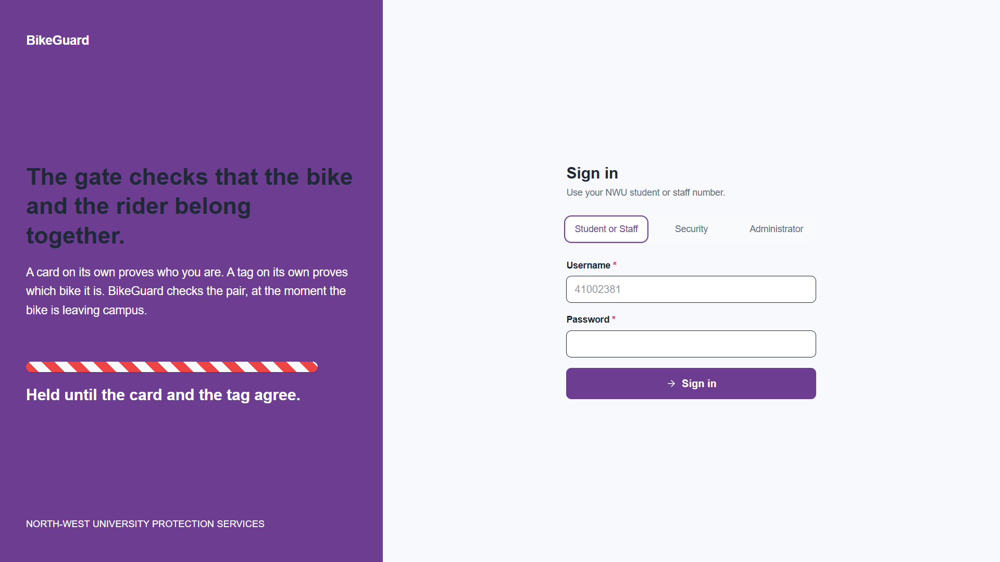
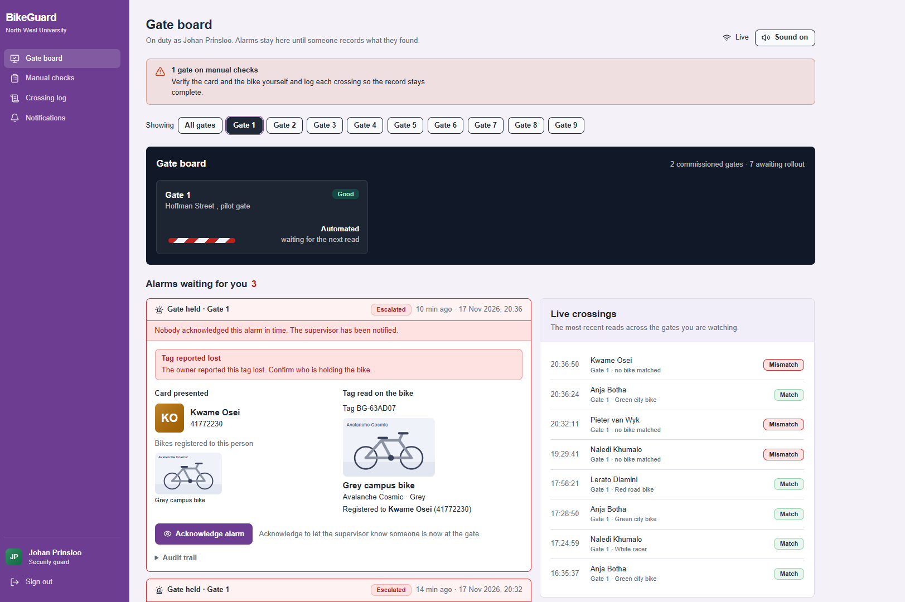
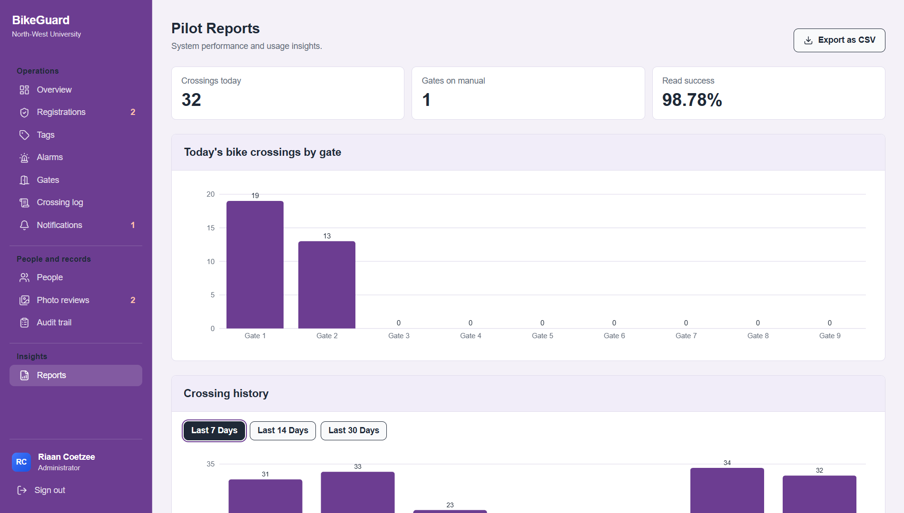
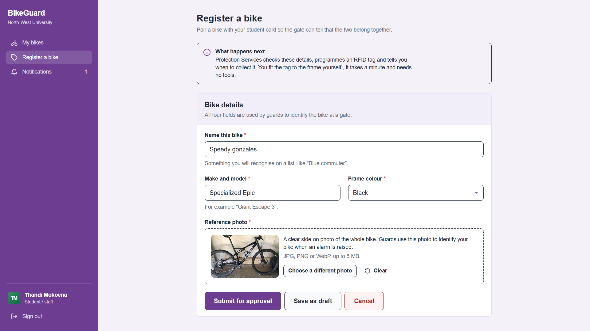
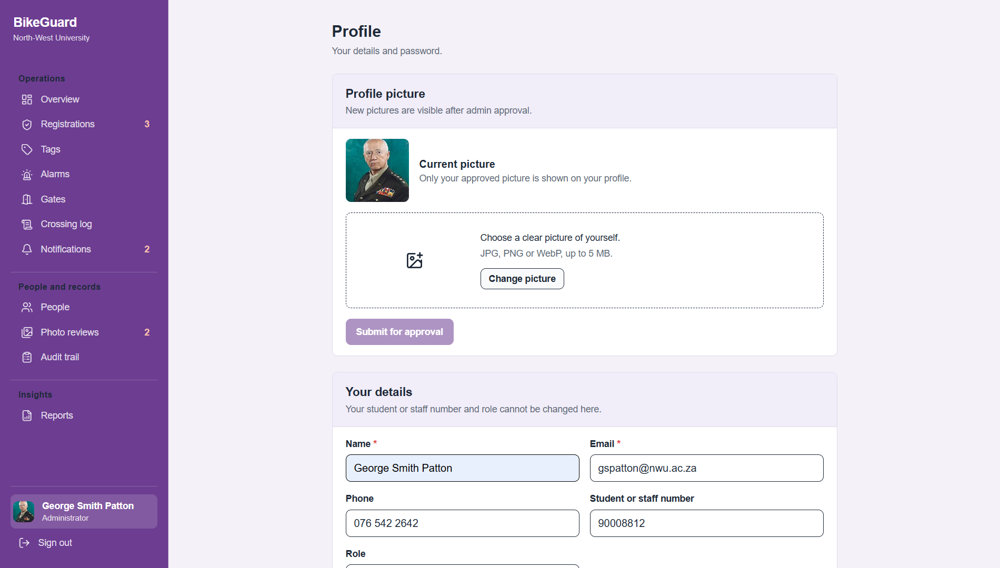

# BikeGuard Frontend



Web app for BikeGuard, the RFID bicycle security and gate verification platform for the NWU campus. It serves four roles: students (register bikes, see notifications), guards (live gate dashboard, manual checks, alarms), managers (alarm history, reports) and admins (people, gates, tags, card linking, photo review, audit log, reports).

The matching API lives in the [backend repo](https://github.com/MCMeyer416/BikeGuard-backend).

> **Try it without a backend:** the app ships with a built-in mock API, so `npm install && npm run dev` is all you need. See [Getting started](#getting-started).

## Screenshots

**Guard gate board:** live crossings, alarms and the card-vs-tag check


**Admin pilot reports:** KPIs, crossings by gate and crossing history


| Register a bike | Profile & photo approval |
|---|---|
|  |  |

## Features

- **Students:** register bikes with a reference photo, manage their profile (picture changes need admin approval), receive notifications
- **Guards:** live gate board over Socket.io, alarm acknowledgement, manual checks when a gate is offline, crossing log
- **Managers:** alarm history and reports
- **Admins:** people, gates, RFID tags, card linking, photo reviews, audit trail, and pilot reports with CSV export

## Stack

React 18, TypeScript, Vite, Tailwind CSS 4, TanStack Query, React Router, Socket.io (live gate events), Recharts, Vitest + Testing Library.

## Getting started

```bash
cp .env.example .env.local
npm install
npm run dev        # http://localhost:5173
```

| Variable | Meaning |
|---|---|
| `VITE_API_MODE` | `live` talks to the backend; `mock` (the default if unset) uses the in-browser mock API in `src/mocks/` |
| `VITE_API_BASE_URL` | e.g. `http://localhost:3000/api/v1` |
| `VITE_REALTIME_URL` | e.g. `http://localhost:3000` |

For live mode, start the backend first (`npm run migrate && npm run seed && npm run dev` there). Sample logins are in the backend README.

## Scripts

`npm run dev` · `npm run build` · `npm run preview` · `npm run lint` (type check) · `npm test`

## Structure

`src/api` (client, endpoints, queries, realtime) · `src/auth` · `src/features/{student,guard,manager,admin,shared}` · `src/components/{ui,domain,layout}` · `src/mocks` · `src/tests`. API details for profile/photo endpoints: `docs/api-profile.md`.

## Deployment

`npm run build` outputs a static site to `dist/`. Set `VITE_API_MODE=live`, `VITE_API_BASE_URL` and `VITE_REALTIME_URL` to point at the deployed backend.

## Team

Built for CMPG 323 at North-West University.

| Name | Role |
|---|---|
| Carlo Barnardo | Project Manager |
| Ashton Manson | Project Leader |
| Keanen Reeve | Backend Lead |
| Reuben Esterhuizen | Backend Developer |
| MC Meyer | Frontend Lead |
| Marno Visser | Frontend Developer |
| Altofino Zunguze | Frontend Developer |
